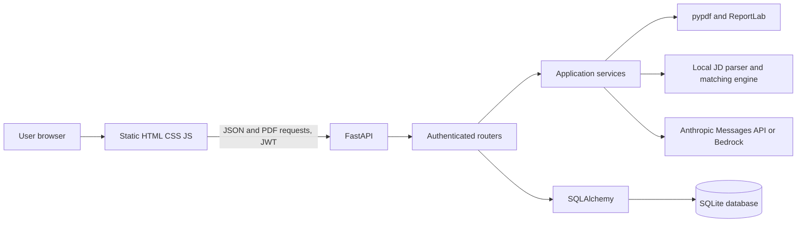
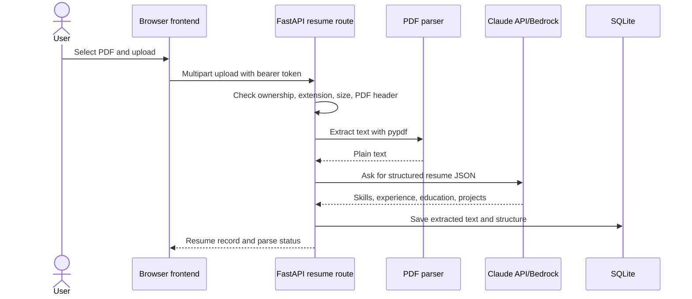
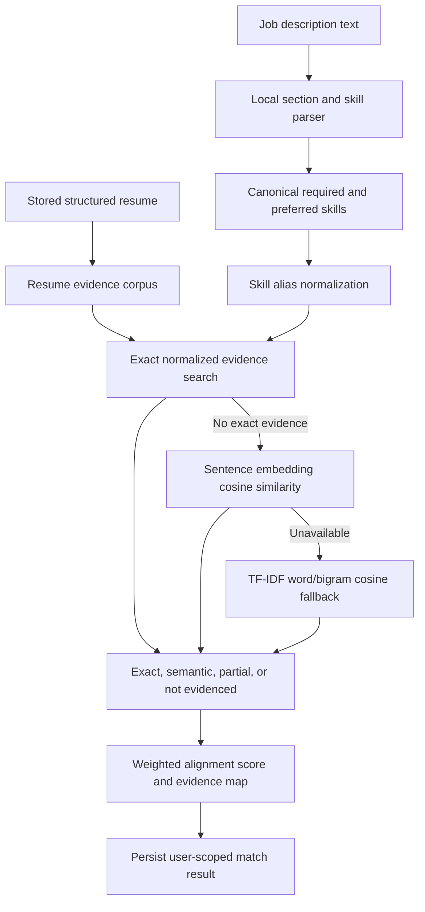

# AI Resume Tailor

A final-year project demonstrating resume parsing, job-description alignment, AI-assisted resume tailoring, interview practice, and application tracking. The system is a local-first prototype. It does not predict hiring outcomes.

## Features

- Account registration and login with bcrypt password hashing and JWT bearer authentication.
- PDF resume upload with `.pdf` extension, PDF magic-byte, and 5 MiB size checks; extracts text with pypdf and asks Claude to return structured resume JSON.
- Job-specific resume tailoring and cover-letter generation through Claude, with prompts that prohibit invented skills and metrics.
- ATS-style matching with skill evidence, missing/partial requirements, recommendations, and a document-alignment score.
- Resume improvement suggestions, skill-gap analysis and roadmap, job application tracker, and interview practice with answer feedback and saved attempts.
- User-scoped history and ATS-oriented PDF exports.

The AI-generated documents still need human review. A resume/JD score is an estimate of the evidence visible in the documents; it is not a candidate assessment or hiring prediction.

## Architecture

The frontend is static HTML/CSS/JavaScript with no build step. FastAPI exposes authenticated JSON routes. Routers validate requests and enforce ownership; service modules perform parsing, matching, document generation, and AI calls; SQLAlchemy persists application data in SQLite by default.



### Resume processing



### Matching workflow



## Technology and dependencies

| Area | Technology |
|---|---|
| Runtime | Python 3.12 recommended; tested here on Python 3.12.0 |
| API | FastAPI, Uvicorn, Pydantic 2 |
| Persistence | SQLAlchemy 2, SQLite by default |
| Authentication | python-jose JWT, passlib/bcrypt |
| AI | Anthropic Python SDK; optional Anthropic Bedrock client via boto3 |
| Resume input/output | pypdf, ReportLab |
| Matching | sentence-transformers `all-MiniLM-L6-v2` when loadable; scikit-learn TF-IDF fallback; NumPy |
| Rate limiting | slowapi |
| Frontend | Vanilla HTML, CSS, JavaScript |
| Tests | pytest, httpx, pytest-mock |

Pinned and bounded package versions are in [`requirements.txt`](requirements.txt). Sentence Transformers may need to download `all-MiniLM-L6-v2` the first time it is loaded. If unavailable, the engine falls back to TF-IDF; this can change match results and latency. The synthetic evaluation uses a deterministic injected word-overlap function instead of either production backend.

The default Claude model configured in the project is `claude-sonnet-5`. Anthropic’s model lifecycle page lists it as active as of 27 October 2026; model availability and Bedrock identifiers depend on provider/account/region and can change. Confirm the target model is enabled for your account before a live demo: [Anthropic model lifecycle](https://docs.anthropic.com/en/docs/about-claude/model-deprecations). The project does not train or fine-tune an ML model.

## Windows installation and run

Use PowerShell. From the project folder:

```powershell
py -3.12 -m venv .venv
.\.venv\Scripts\python.exe -m pip install --upgrade pip
.\.venv\Scripts\python.exe -m pip install -r requirements.txt
Copy-Item .env.example .env
notepad .env
```

Edit `.env` and replace the placeholder `ANTHROPIC_API_KEY` and `JWT_SECRET_KEY`. Generate a 64-character JWT secret with:

```powershell
.\.venv\Scripts\python.exe -c "import secrets; print(secrets.token_hex(32))"
```

Run the API in one PowerShell window:

```powershell
Set-Location backend
..\.venv\Scripts\python.exe -m uvicorn main:app --host 127.0.0.1 --port 8000 --reload
```

Serve the static frontend from another window, at the project root:

```powershell
.\.venv\Scripts\python.exe -m http.server 5500 --bind 127.0.0.1 --directory frontend
```

Open [http://127.0.0.1:5500](http://127.0.0.1:5500), create an account, upload a text-based PDF, then try the matching or tailoring workflow. FastAPI docs are at [http://127.0.0.1:8000/docs](http://127.0.0.1:8000/docs). Do not open pages with `file://`; use the local server so CORS matches the configured origin.

### Configuration

`backend/main.py` loads `.env` without overriding variables already supplied by the process/container. Explicit environment values therefore take precedence. Resume uploads are read with a 5 MiB + 1 byte cap before rejection to limit application memory use for oversized files.

| Variable | Required | Default | Purpose |
|---|---|---|---|
| `ANTHROPIC_API_KEY` | Yes for direct Anthropic | — | Claude API credential |
| `JWT_SECRET_KEY` | Yes | — | JWT signing secret; use a random value of at least 32 characters |
| `ANTHROPIC_MODEL` | No | `claude-sonnet-5` | Provider-supported Claude model identifier |
| `CLAUDE_CODE_USE_BEDROCK` | No | `false` | Use the Anthropic Bedrock client when true |
| `AWS_REGION` | No | `us-east-1` | Bedrock region |
| AWS credential chain | Bedrock only | SDK chain | Configure AWS credentials outside source control |
| `DATABASE_URL` | No | `sqlite:///./resume_tailor.db` | SQLAlchemy URL; Docker Compose sets a persistent `/data` path |
| `DEBUG` | No | `false` | When true, additionally permits `null` CORS origin for local file pages; avoid in deployment |

Startup configuration checks log warnings but do not stop the app. A missing AI credential allows non-AI endpoints to start but AI-dependent endpoints will fail. Use a Bedrock model identifier supported in the selected region when using Bedrock; Bedrock access was not exercised for this review.

## Database and migrations

On startup, the app imports its model definitions and calls SQLAlchemy `Base.metadata.create_all`. This creates missing tables on a fresh SQLite database, which is covered by the test setup. **There is no Alembic or other schema migration system.** `create_all` does not alter existing tables when columns or constraints change. For an existing database, back it up and use an explicit migration before upgrading; do not assume a new code version is safe to run against an old schema. SQLite is the configured and dependency-supported default, suitable for a local demonstration, not a multi-instance production deployment. A different SQLAlchemy URL would also require installing and configuring the appropriate database driver, which is not included in the requirements.

## Docker

Docker files are included for the API only. The Docker command uses `main:app` from `/app/backend`, matching the app's absolute imports. Docker itself was not available during this review, so an image build or container startup is **not verified**.

```powershell
Copy-Item .env.example .env
# Edit .env with real Anthropic key and strong JWT secret
docker compose up --build
```

The API is exposed on port 8000 and SQLite data is stored in the named `db_data` volume. The frontend is not included in the container; run the static server command above separately. `docker compose down` preserves the named volume; deleting the volume deletes its database. Never bake `.env` or a database into an image.

## API overview

All application data routes require `Authorization: Bearer <token>` and scope records to the current user. Interactive OpenAPI documentation is available at `/docs` while the server runs.

| Route group | Main operations |
|---|---|
| `/auth` | `POST /signup`, `POST /login`, `POST /token` |
| `/resumes` | Upload, list, read, delete |
| `/tailor` | Create tailored resume, list and read |
| `/cover-letter` | Generate, update, fetch for tailored resume |
| `/history` | List and delete tailored history |
| `/match` | Run, list, read, delete matching results |
| `/improve` | Generate and manage improvement suggestions; apply accepted changes |
| `/skill-gap` | Create/read/update/delete learning roadmaps |
| `/tracker` | Create/list/read/update/delete applications and stats |
| `/interview` | Generate sessions, save answers, compare attempts, delete sessions |
| `/export` | Download tailored resume or cover-letter PDFs |
| `/health`, `/me` | Health check; authenticated current-user profile |

The backend uses per-user rate limits on selected Claude-calling routes. Check each router for current limits and request schemas; rate limiting is in-memory and is not a distributed production limiter.

## Matching formula and model choice

The overall score is a weighted document-alignment heuristic:

```text
overall = round(
    0.40 * required_skill_score
  + 0.15 * preferred_skill_score
  + 0.30 * experience_score
  + 0.15 * education_score
)
```

Components are 0–100. Required and preferred skill scores average confidence across normalized unique requirements. Exact aliases yield confidence 1.0. Similarity at or above 0.65 is categorized semantic; 0.45–0.65 is partial and receives half similarity weight; lower similarity is not evidenced. Experience combines a 50-point experience-entry base, up to 30 points for responsibility similarity, and up to 20 for a heuristic date-range years estimate; no experience entry returns 10. Education is 70 when the JD has no detectable level, 90 for meeting it, 100 for exceeding it, 40 below it, and 20 when education is absent. See [`backend/MATCHING_ENGINE.md`](backend/MATCHING_ENGINE.md) for details.

The production similarity implementation uses `all-MiniLM-L6-v2` sentence embeddings and cosine similarity when the library/model loads; otherwise it uses per-pair TF-IDF word/bigram cosine similarity. The JD parser is local regex/header and known-skill extraction; Claude is used in parsing uploaded resume text and in the tailored-document and coaching workflows, not as the matching score model.

## Testing and measured evaluation

From `backend`:

```powershell
..\.venv\Scripts\python.exe -m pytest tests -q
..\.venv\Scripts\python.exe tests\evaluation\run_eval.py
```

The complete suite passed **324 tests** on the final reviewed checkout (with dependency deprecation warnings). AI calls in tests are mocked. The evaluation contains 11 synthetic resume/JD pairs and compares the engine to a substring keyword baseline. Measured micro F1 was 0.952 for the matching engine and 0.850 for the baseline; evidence source localization was 21/22. These are results on a small hand-labelled diagnostic dataset, not general performance claims. Ranking quality is not evaluated because cases do not share a JD across multiple candidate resumes. Full method, metrics, per-case results, latency observations, limitations, and reproduction commands are in [`PHASE8_EVALUATION.md`](PHASE8_EVALUATION.md) and [`backend/tests/evaluation/results.json`](backend/tests/evaluation/results.json).

## Security, privacy, and submission

- `.env` contains secrets and is ignored by Git and Docker build context. Do not commit or submit it.
- SQLite databases contain extracted resume text, structured resume data, job descriptions, answers, and application records. They are ignored and excluded from the safe submission archive. Treat them as private; do not share them.
- The uploaded PDF bytes are parsed during upload; the app stores extracted text and structured data rather than retaining the original file bytes.
- Passwords are bcrypt-hashed; protected records are filtered by authenticated user ID. These application controls do not encrypt the SQLite file at rest.
- The API currently uses local HTTP in the demo. Do not expose it to an untrusted network without HTTPS, production-grade secret management, stronger deployment controls, and a migration/backup plan.
- AI providers receive the user content needed for their requested operations. Review provider terms and account settings before using real personal data.
- Use `python tools/package_submission.py` to create `dist/ai_resume_tailor_submission.zip`. The packager uses an explicit source allowlist and excludes `.env`, databases, virtual environments, caches, and local build outputs. The packager prints and validates the archive contents.

## Troubleshooting

| Symptom | Check |
|---|---|
| AI endpoint returns an error | Confirm `ANTHROPIC_API_KEY`, model access, internet connectivity, and startup logs; with Bedrock, check region and AWS credentials/model access. |
| `401` from a protected page | Log in again; the app stores JWT in localStorage key `token`. |
| Browser CORS error | Serve frontend at `http://127.0.0.1:5500` and API at `http://127.0.0.1:8000`; do not use `file://`. |
| Resume upload rejects the PDF | Upload a text-based PDF under 5 MiB; encrypted, malformed, image-only, or empty PDFs are rejected. |
| Match results differ by machine | Check whether `sentence-transformers` loaded or TF-IDF fallback was used; first model load may download weights. |
| Existing database fails after upgrade | Schema migrations are not implemented. Restore a backup and apply a deliberate migration; a fresh database is supported. |
| Docker Compose reports missing `.env` | Copy `.env.example` to `.env` and fill in the required secrets before running Compose. |

## Project documents

- [Phase 8 evaluation report](PHASE8_EVALUATION.md)
- [Viva preparation guide](VIVA_GUIDE.md)
- [Final release-readiness review](RELEASE_READINESS.md)
- [Detailed matching formula](backend/MATCHING_ENGINE.md)
